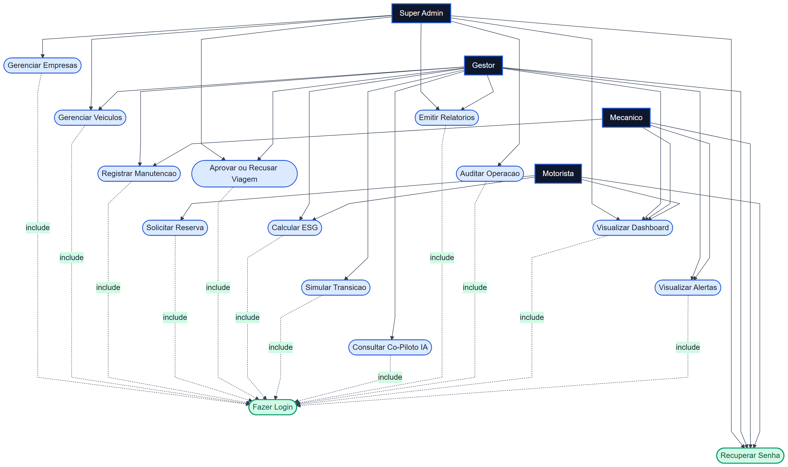
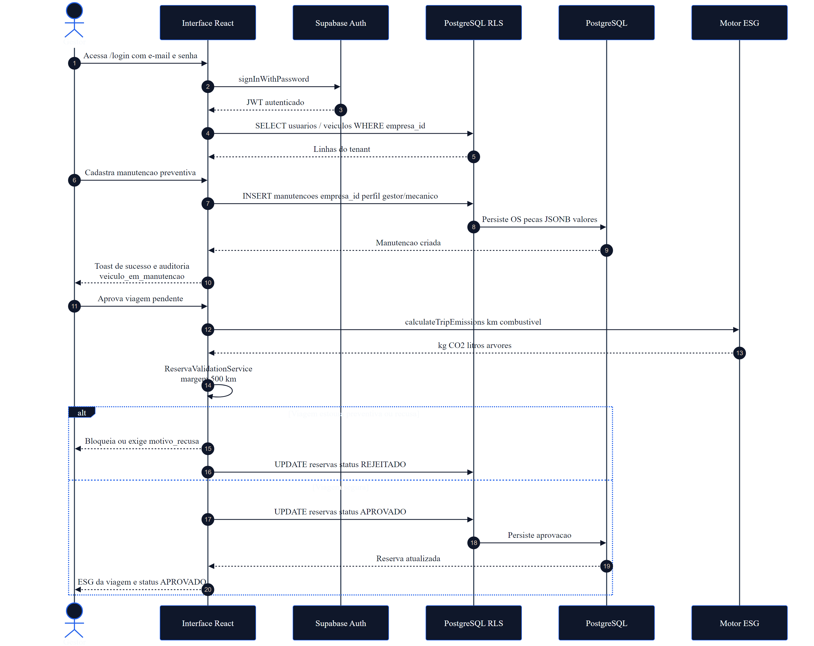
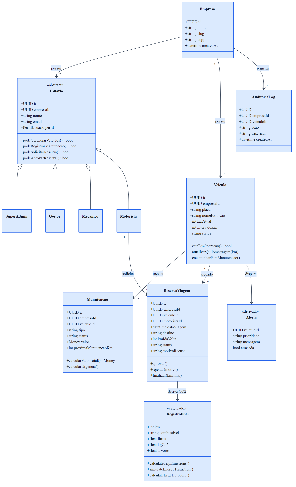
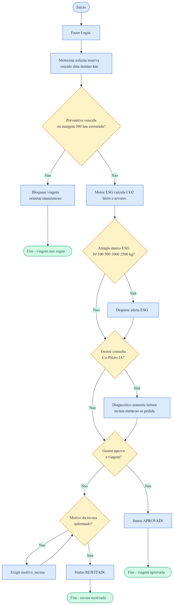
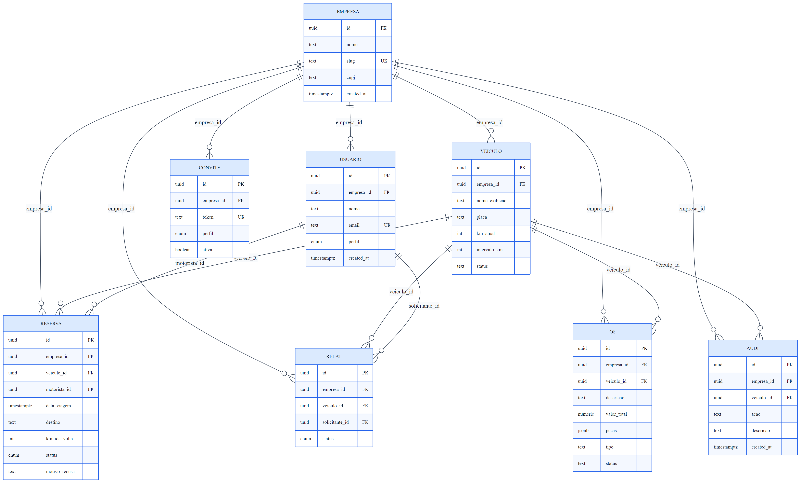

# FrotaMaq — Plataforma Web Inteligente para Gestão de Manutenção de Frotas, Análise ESG e Apoio à Decisão com IA

**Trabalho de Conclusão de Curso**

| | |
|---|---|
| **Autores** | Gabriel Felipe Spohn, Gustavo Henrique da Silva, Lucas Eduardo de Lima |
| **Local** | Cascavel, Paraná |
| **Título** | FrotaMaq — Plataforma Web Inteligente para Gestão de Manutenção de Frotas, Análise ESG e Apoio à Decisão com IA |
| **Stack real** | React 19, Vite 8, TypeScript 6, Tailwind CSS 4, Supabase (PostgreSQL + Auth + RLS), Google Gemini, Vitest 5, GitHub Actions / GitHub Pages |

Diagramas oficiais (alta resolução) em `docs-tcc/diagramas/`.

---

## Resumo

Este trabalho apresenta o **FrotaMaq**, aplicação web *Single Page Application* para gestão de manutenção de frotas e maquinário, com mensuração ESG e apoio à decisão por inteligência artificial generativa. O sistema foi implementado em **React 19**, **TypeScript** e **Vite 8**, estilizado com **Tailwind CSS 4**, e utiliza o **Supabase** como *Backend as a Service*: PostgreSQL, autenticação e **Row Level Security** para isolamento multiempresa. Três pilares de inovação estão no código: (i) a **Calculadora ESG**, que estima CO₂ a partir do KM das viagens; (ii) o **Simulador de Transição Energética (ROI Verde)** e o **Índice FrotaMaq ESG & Eficiência (0–100)**; (iii) o **Co-Piloto IA** (Google Gemini) em modo somente leitura, com recusa de mutação e fallback heurístico. A segurança é verificada por **14 testes Vitest** (IDOR, segredos, injeção e brute force) e pela esteira **GitHub Actions**. Não há backend Express/Prisma nem cliente React Native no repositório entregue.

**Palavras-chave:** gestão de frotas; SPA React/Vite; Supabase; RLS; ESG; simulador de transição energética; Google Gemini; DevSecOps.

## Abstract

FrotaMaq is a web SPA for fleet maintenance, ESG measurement and generative-AI decision support. It is built with React 19, TypeScript, Vite 8 and Tailwind CSS 4, using Supabase (PostgreSQL, Auth and Row Level Security) instead of a custom Express/Prisma API. Innovation pillars in source code include an ESG calculator, an energy-transition simulator with a 0–100 sustainability score, and a read-only Google Gemini copilot with mutation guardrails and a local heuristic fallback. Security is enforced by PostgreSQL RLS and a 14-test Vitest suite, deployed via GitHub Actions to GitHub Pages.

**Keywords:** fleet management; React/Vite SPA; Supabase; RLS; ESG; energy transition; Gemini; DevSecOps.

---

## Capítulo 1 — Introdução

Empresas de transporte e de maquinário pesado precisam (1) manter a frota disponível com preventiva rastreável, (2) mensurar emissões de CO₂ sem planilhas paralelas e (3) consultar a operação em linguagem natural **sem** permitir que um assistente altere dados de produção. O FrotaMaq responde a essas dores em uma SPA autenticada, multi-tenant e auditável.

**Objetivo geral:** desenvolver e documentar uma plataforma web inteligente para manutenção de frotas, ESG e IA, implantável via CI/CD.

**Objetivos específicos (implementados):** modelar frota, OS, reservas, convites, relatórios e auditoria em PostgreSQL com RLS; aplicar RBAC de quatro perfis; calcular ESG e simular eletrificação/etanol; oferecer Co-Piloto somente leitura; automatizar testes de segurança e o deploy.

## Capítulo 2 — Fundamentação teórica

**SPA (React, Vite, TypeScript).** A interface executa no navegador e conversa com APIs HTTPS. O Vite empacota o cliente; o React Router 7 resolve rotas no cliente — no GitHub Pages o *fallback* `404.html` restaura o caminho após F5.

**BaaS e RLS (Supabase).** Em vez de API REST própria, o PostgREST e o GoTrue concentram persistência e identidade. A RLS avalia `empresa_id` e perfil em funções `SECURITY DEFINER` (`auth_user_empresa_id()`, `auth_user_perfil()`).

**IA generativa em negócios (Gemini).** Consulta em linguagem natural sobre um *snapshot* fechado. O risco de alucinação e de escrita indevida é mitigado por recusa de mutação e heurística determinística.

**ESG na logística.** Estimativa simplificada de Escopo 1 (combustão da frota) a partir do KM. O simulador traduz a mesma base em custo (R$) e redução percentual de CO₂.

**DevSecOps.** Vitest + GitHub Actions incorporam IDOR, XSS, SQLi e brute force na esteira (`security-tests.yml`, `ci.yml`, `deploy.yml`).

## Capítulo 3 — Metodologia

O desenvolvimento seguiu Clean Architecture dentro de `src/` (`domain`, `application`, `infrastructure`, `pages`). Requisitos foram extraídos das telas reais. Testes unitários, de integração e de segurança foram executados com Vitest. Os diagramas UML/ER deste volume foram gerados a partir do código e renderizados com Mermaid CLI.

## Capítulo 4 — Requisitos

Ver documento complementar `02_DOCUMENTO_DE_REQUISITOS.md`. Em síntese: RF01–RF34 cobrem login, frota, OS, reservas com recusa motivada, ESG, simulador, score, IA, relatórios e auditoria; RNF01–RNF15 cobrem RLS, IDOR, XSS, SQLi, brute force, fallbacks e CI/CD; RN01–RN24 incluem fatores de emissão, margem de 500 km e faixas do score.

## Capítulo 5 — Modelagem

Os casos de uso autenticados **incluem** obrigatoriamente *Fazer Login* (Figura 1). O fluxo de OS e aprovação de viagem com ESG e RLS está na Figura 2. As classes de domínio — incluindo `RegistroESG` e `Alerta` como conceitos **calculados/derivados**, não tabelas — estão na Figura 3. A atividade de decisão da viagem está na Figura 4. O ER canônico do PostgreSQL está na Figura 5.

| Figura | Arquivo PNG / SVG |
|---|---|
| 1. Casos de uso | `diagramas/01_diagrama_casos_de_uso.png` |
| 2. Sequência OS + viagem + ESG + RLS | `diagramas/02_diagrama_sequencia.png` |
| 3. Classes | `diagramas/03_diagrama_classes.png` |
| 4. Atividade da viagem | `diagramas/04_diagrama_atividade.png` |
| 5. ER PostgreSQL/Supabase | `diagramas/05_diagrama_banco_er.png` |

**Figura 1 — Diagrama de casos de uso.**



**Figura 2 — Diagrama de sequência (OS, viagem, ESG e RLS).**



**Figura 3 — Diagrama de classes.**



**Figura 4 — Diagrama de atividade da viagem.**



**Figura 5 — Diagrama entidade-relacionamento (PostgreSQL/Supabase).**



**Legenda da Figura 5 (tabelas reais):** `EMPRESA` = `empresas`; `USUARIO` = `usuarios`; `VEICULO` = `veiculos`; `OS` = `manutencoes`; `RESERVA` = `reservas`; `CONVITE` = `chaves_convite`; `RELAT` = `solicitacoes_relatorio`; `AUDIT` = `audit_logs`. Cardinalidades 1:N via `empresa_id` / `veiculo_id` / `motorista_id`. **Não existem** tabelas `abastecimentos` nem `emissoes`. Os nomes curtos no diagrama usam um caractere extra de padding no fonte Mermaid para compensar o recorte da última letra no cabeçalho; a correspondência acima é a fonte de verdade.

## Capítulo 6 — Arquitetura e implementação

```
Navegador (React 19 + Vite 8)
  pages/components → services → use-cases → domain
                         ↓
              infrastructure/repositories → Supabase
                         ↓
              Gemini / Nominatim / OSRM
```

Composition root: `src/infrastructure/di/container.ts`. Rotas em `src/App.tsx` com `basename` de `getRouterBasename()` (produção Pages = `/FrotaMaq`). Design system em `01_DESIGN_SYSTEM_PALETA_CORES.md`.

Módulos de inovação:

1. **ESG** — `src/utils/esgCalculator.ts`
2. **Simulador / Score** — `esgTransition.ts`, `esgFleetScore.ts`
3. **IA** — `src/services/aiService.ts` (modelos `gemini-3.1-flash-lite` / fallbacks; prompt “Especialista Sênior”; `isMutationRequest`)

## Capítulo 7 — Segurança, testes e CI/CD

RLS no PostgreSQL; tenant na aplicação; RBAC na UI. Suíte `npm run test:security` com 14 casos (detalhados em `03_CASOS_DE_TESTE.md`). Vitest: 237 testes. Workflows Node 22: build+test, security, deploy Pages (`upload-pages-artifact@v3`, `deploy-pages@v4`).

## Capítulo 8 — Resultados

O produto apresentado à banca é a SPA em produção no GitHub Pages, com Dashboard (KPIs + índice ESG + simulador + Co-Piloto), frota, OS, reservas com recusa motivada, relatórios PDF/CSV e auditoria. A suíte de segurança passou 14/14. O build de produção (`tsc -b && vite build`) conclui com sucesso.

## Capítulo 9 — Conclusão e trabalhos futuros

O FrotaMaq une operação, sustentabilidade mensurável e IA restrita a leitura, sobre PostgreSQL com RLS — sem React Native/Express/Prisma. Trabalhos futuros: persistir inventário de emissões; promover `tipo_combustivel` a coluna oficial; recriar `alertas` no schema ou remover o repositório *stub*; ampliar E2E Playwright; alinhar fatores ao GHG Protocol.

---

## Referências

GOOGLE. *Gemini API documentation*. 2025.  
POSTGRESQL GLOBAL DEVELOPMENT GROUP. *Row Security Policies*.  
REACT. *React documentation*. 2025.  
SUPABASE. *Row Level Security*.  
VITE. *Vite documentation*.  
VITEST. *Vitest documentation*.  
W3C. *Web Content Accessibility — empty states and forms*.  

Documentos internos do projeto: `src/ARCHITECTURE.md`; `supabase/frota_maq_recreate_complete.sql`; `supabase/migration_audit_logs.sql`; `docs-tcc/01_DESIGN_SYSTEM_PALETA_CORES.md`; `docs-tcc/02_DOCUMENTO_DE_REQUISITOS.md`; `docs-tcc/03_CASOS_DE_TESTE.md`.
